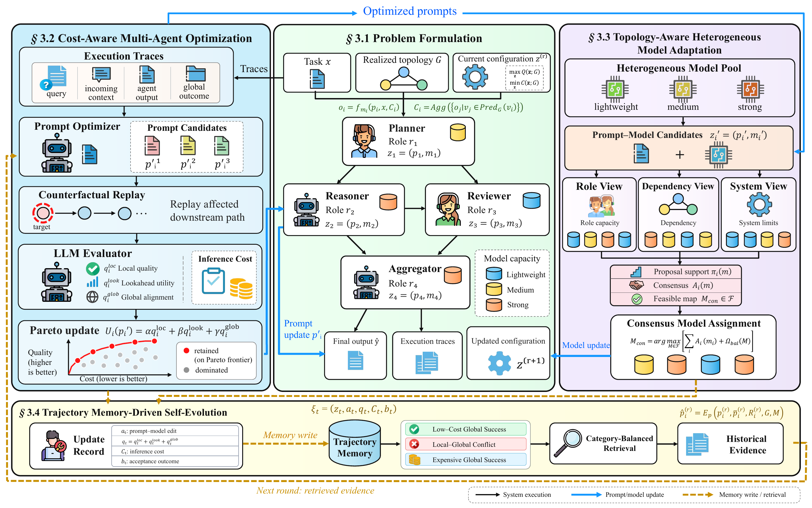

# UniMASO

This repository provides the implementation of **Not Every Agent Needs the Strongest Model: Unified Prompt–Model Optimization for Heterogeneous LLM-based Multi-Agent Systems** (UniMASO).

## 🧠 About UniMASO
LLM-based multi-agent systems use role-specific prompts and models to solve complex tasks, but existing prompt optimization usually keeps model assignments fixed. UniMASO jointly optimizes prompts and model assignments, using cost-aware Pareto search, topology-aware co-evolution, and cross-level trajectory memory. Experiments on five benchmarks and five execution topologies show competitive task performance at lower deployment cost. Under centralized execution, UniMASO improves the average score from 69.79 to 70.40 while reducing token-weighted deployment cost by 85.2% relative to DeepSeek-V4-Pro with MASPO.

It consists of three key components:

* **Cost-aware multi-level feedback:** Evaluates candidate updates using local, downstream, and global feedback, and preserves quality–cost trade-offs through Pareto search.
* **Topology-aware co-evolution:** Coordinates prompt and model updates according to agent roles and dependencies.
* **Cross-level trajectory memory:** Reuses previous successes and failures to guide later optimization.

## The Framework of UniMASO

<p align="center">
  
</p>

## 📖 Parameter Reference for `run_unimaso.py`
This script is the main entry point for multi-agent evaluation and UniMASO optimization.

### Basic Arguments

Argument | Type | Default | Description
--- | --- | --- | ---
`--dataset` | `str` | Required | Dataset identifier, e.g. `math`, `agi`, or `aqua`.
`--graph` | `str` | `Sequential` | Multi-agent topology.
`--sample-size` | `int` | All samples | Number of samples used for evaluation.
`--max-concurrent` | `int` | `20` | Maximum number of concurrent evaluation tasks.
`--nr` | `int` | `1` | Reflection rounds for the `Sequential` topology.

### Optimization Arguments

Argument | Type | Default | Description
--- | --- | --- | ---
`--optimize` | `flag` | `False` | Enable optimization before evaluation.
`--prompt-file` | `str` | `None` | Load a saved prompt/model configuration for evaluation.
`--agent-model` | `str` | `qwen35-4b` | Model used for agent inference.
`--optimizer-model` | `str` | `deepseek-v4-flash` | Model used to propose prompt updates.
`--evaluator-model` | `str` | `deepseek-v4-flash` | Model used by optimization evaluators.
`--hetero` | `flag` | `False` | Jointly optimize prompts and per-agent model assignments.
`--model-pool` | `str` list | Configured models | Candidate models for heterogeneous optimization.
`--lambda-cost` | `float` | `0.0` | Cost weight; set a positive value to make optimization cost-aware.

### Optimization Mode Selection

Argument | Type | Default | Description
--- | --- | --- | ---
`--round-robin` | `flag` | `False` | Optimize agents in round-robin order.
`--fixed-rounds` | `flag` | `False` | Optimize each agent for a fixed number of rounds per turn.
`--depth` | `int` | `10` | Maximum optimization depth per agent.
`--rounds-per-turn` | `int` | `1` | Optimization steps per agent in each fixed-round turn.

### Advanced Optimization Strategies

Argument | Type | Default | Description
--- | --- | --- | ---
`--beam-refresh` | `flag` | `False` | Re-score candidates when partner prompts change.
`--feedback` | `flag` | `False` | Pass downstream failure cases to upstream agents.
`--misleading-sampling` | `flag` | `False` | Sample cases where local success led to a poor global result.
`--lookahead-score` | `flag` | `False` | Score candidates using local, downstream, and global performance.
`--trajectory-memory [N]` | optional `int` | Off | Retrieve up to `N` items from trajectory memory.
`--co-evolver [MODEL]` | optional `str` | Off | Enable model-assignment co-evolution.

## 🚀 Quick Start

### Installation

Install the core dependencies and configure the API keys or local model endpoints used by your selected models.

```bash
pip install openai dashscope numpy tqdm faiss-cpu
```

### Usage Examples

Configure the API keys and model endpoints used by the selected models before running. Trajectory memory uses the embedding endpoint configured in `config.py`.

```bash
# Run optimization (BFCL-v3, Centralized)
python3 -u run_unimaso.py \
  --dataset bfcl_v3 \
  --graph Centralized \
  --max-concurrent 40 \
  --optimize --hetero --fixed-rounds \
  --flexible-round-depths 3,2,2 \
  --beam-refresh --lookahead-score --lookahead-weights 4:4:2 \
  --lambda-cost 0.2 \
  --agent-model qwen35-9b \
  --optimizer-model qwen35-27b \
  --evaluator-model qwen35-27b \
  --model-pool qwen35-4b qwen35-9b qwen35-27b deepseek-v4-flash deepseek-v4-pro \
  --co-evolver deepseek-v4-flash --voter trace_entropy \
  --trajectory-memory 2 --seed 42

# Re-evaluate using the optimized prompts and model assignments
python3 -u run_unimaso.py \
  --dataset bfcl_v3 \
  --graph Centralized \
  --prompt-file path/to/optimized_config.json \
  --max-concurrent 40 --seed 42
```

Replace `path/to/optimized_config.json` with the prompt configuration path printed by the optimization run.

## 📜 Citation

```bibtex
@misc{cai2026unimaso,
  title         = {Not Every Agent Needs the Strongest Model: Unified Prompt--Model Optimization for Heterogeneous LLM-based Multi-Agent Systems},
  author        = {Cai, Mingxiu and Xian, Haoyang and Ma, Xinyu and Wang, Yutong and Song, Zhenxi and Li, Jing and Liu, Xuebo},
  year          = {2026},
  eprint        = {2610.31743},
  archivePrefix = {arXiv},
  primaryClass  = {cs.MA},
  url           = {https://arxiv.org/abs/2610.31743}
}
```
